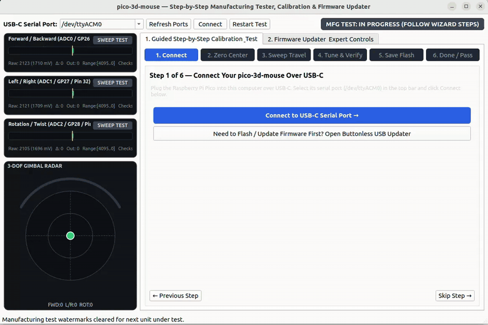
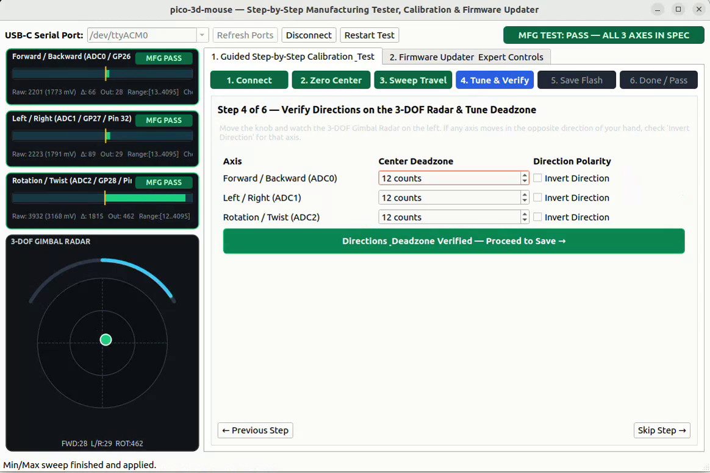
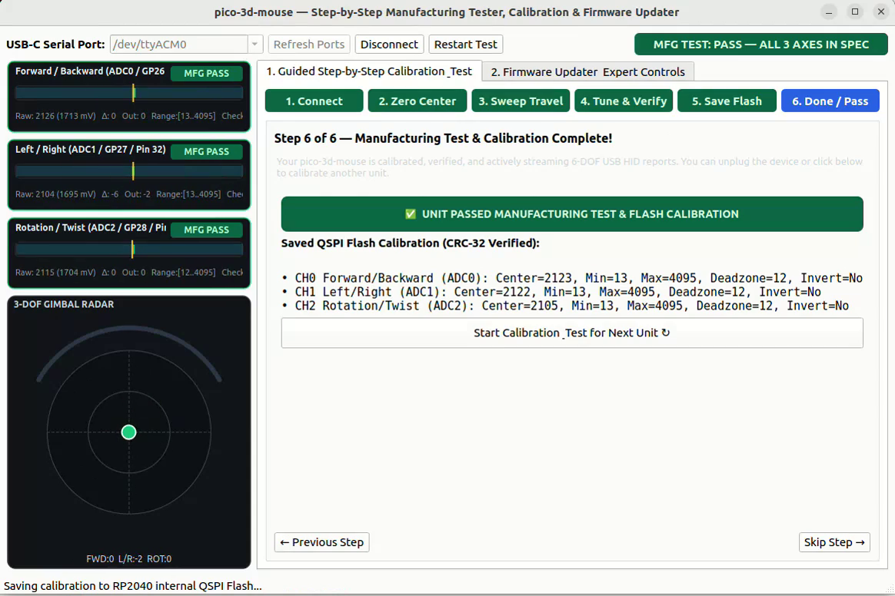

# pico-3d-mouse

Self-contained RP2040 3D mouse firmware and cross-platform Qt6 MVC Manufacturing Tester, Calibration & Buttonless Firmware Updater built in **100% C++17**, following **SOLID** design principles and full off-target **TDD** (GoogleTest + GMock).

## Manufacturing Tester & Calibration Wizard Demo

[](docs/media/manufacturing_demo.mp4)

> **Video**: [Watch / Download Full MP4 (`docs/media/manufacturing_demo.mp4`)](docs/media/manufacturing_demo.mp4)

### Screenshots

| Live 3-DOF Telemetry & Direction/Deadzone Tuning | Final Manufacturing Pass & QSPI Flash Sign-Off |
| :---: | :---: |
|  |  |

## Key Features

- **Composite USB-C 3Dconnexion SpaceMouse (`0x256F:0xC631`)**:
  - **Windows & macOS `3DxWare 10` / Autodesk Fusion 360 Compatible** (Interface 2): Emulates the **3Dconnexion SpaceMouse Pro Wireless (cabled) (`VID = 0x256F`, `PID = 0xC631`)** 6-DOF Multi-Axis Controller HID descriptor (with both Interrupt IN and OUT endpoints, 12-byte 6-DOF `Report ID 1` in `[-350, +350]` with LSB jiggle, `Report ID 3` Buttons, and `Report ID 4` LED) so **3DxWare 10** on Windows 10/11 & macOS (Fusion 360, SolidWorks, Rhino, OnShape) as well as **FreeCAD**, **Blender**, and `spacenavd` recognize the mouse natively.
  - **USB-CDC Telemetry & Calibration Serial** (Interfaces 0 & 1): Uses the standard inbox `usbser.sys` / `cdc_acm` driver (`/dev/ttyACM0` / `COMx`)—with zero unknown vendor interfaces in Windows Device Manager—streaming live oversampled 12-bit ADC readings, millivolts, conditioned deltas, and scaled outputs, and accepting line-based calibration commands (`ZERO`, `CAL_MINMAX_START`, `CAL_MINMAX_END`, `SET_DZ`, `SET_INV`, `SAVE_CAL`, `LOAD_CAL`, `RESET_CAL`, `GET_CAL`, `BOOTSEL`).
  - **100% Buttonless Firmware Updates**: Triggered via the `BOOTSEL` serial command or 1200-baud USB-CDC touch without ever needing a custom vendor interface or pressing the physical button inside the enclosure.
- **Non-Volatile QSPI Flash Calibration Store**:
  - Persists per-axis center bias, min/max mechanical travel limits, deadzone counts, and polarity inversion to the final 4 KB sector of RP2040 internal QSPI Flash, protected by a magic header, schema version, and **IEEE 802.3 CRC-32** checksum.
- **Qt6 MVC Manufacturing Tester, Calibration & Buttonless Firmware Updater (`./scripts/ui`)**:
  - **100% Event-Driven (Zero Polling)**: Powered exclusively by Qt Signals & Slots (`QSerialPort::readyRead`, `QProcess` signals, and MVC model change notifications).
  - **Custom Decoupled SOLID Widgets**:
    - `ManufacturingWizardWidget`: Interactive 6-step operator wizard (Connect -> Zero Resting Center -> Full-Range Axis Sweep -> Direction & Deadzone Check -> Save to QSPI Flash -> Final Sign-Off).
    - `GimbalRadarWidget`: Custom `QPainter` 2D X/Y deflection radar + concentric Twist rotation arc.
    - `AxisGaugeWidget`: Custom `QPainter` 12-bit ADC channel bar (`0..4095`), millivolts, center marker, deadzone band, min/max sweep watermarks, and per-axis Manufacturing Pass/Pending badge.
    - `CalibrationPanelWidget`: Interactive center zeroing, min/max sweep capture, per-axis deadzone spinboxes, polarity inversion checkboxes, and QSPI Flash save/load/reset controls.
    - `FirmwareUpdaterWidget`: **Buttonless USB-C Firmware Updater** designed for enclosed housings where the physical `BOOTSEL` button is inaccessible.

## Hardware Wiring

The Raspberry Pi Pico (RP2040) connects to the host computer over **USB-C**. The three potentiometer outer terminals are tied in parallel across `3V3(OUT)` (Pin 36) and `AGND` (Pin 33), with their wipers routed to `ADC0`, `ADC1`, and `ADC2`:

| Axis / Signal | Potentiometer Terminal | RP2040 GPIO | ADC Channel | Physical Pin |
| :--- | :--- | :--- | :---: | :---: |
| **Forward / Backward** | Wiper | `GP26` | `ADC0` | **Pin 31** |
| **Left / Right** | Wiper | `GP27` | `ADC1` | **Pin 32** |
| **Rotation (Twist)** | Wiper | `GP28` | `ADC2` | **Pin 34** |
| **Potentiometer +V** | High side (all 3 pots) | `3V3(OUT)` | — | **Pin 36** |
| **Potentiometer GND** | Low side (all 3 pots) | `AGND` | — | **Pin 33** |
| **Status LED** | Onboard LED | `GP25` | — | Onboard |


See [docs/WIRING.md](docs/WIRING.md) and [docs/pinout.png](docs/pinout.png) for the full schematic and board pinout.

## SOLID Architecture & Colocated Unit Tests

Every module directory under `src/` owns its `CMakeLists.txt`, public `include/`, implementation, and colocated `test/CMakeLists.txt` unit test suite (59 unit tests across 16 suites):

```text
.
├── CMakeLists.txt                                  # Root host build & CTest entry point
├── flake.nix / flake.lock                          # Hermetic Nix environment (zero external installs)
├── docs/
│   ├── WIRING.md                                   # Detailed schematic & pin wiring diagram
│   ├── pinout.png                                  # RP2040 board pinout
│   └── media/
│       ├── manufacturing_demo.gif                  # Inline README preview of the Manufacturing UI
│       ├── manufacturing_demo.mp4                  # Full-resolution screencast video
│       ├── manufacturing_tester_active.png         # Screenshot: Live 3-DOF telemetry & tuning
│       └── manufacturing_tester_pass.png           # Screenshot: Manufacturing Pass & QSPI Flash sign-off
├── scripts/
│   ├── build                                       # Build host tests, Qt6 UI, and RP2040 UF2 firmware
│   ├── test                                        # Run all 59 colocated unit tests with ASan + UBSan
│   ├── flash                                       # Buttonless auto-build, flash UF2, and capture logs
│   ├── ui                                          # Launch Qt6 MVC Manufacturing Tester & Updater UI
│   └── console                                     # Open interactive picocom console on /dev/ttyACM*
├── src/
│   ├── CMakeLists.txt
│   ├── cmake/p3d.cmake                             # Module & colocated test helpers
│   ├── hal/                                        # Pure abstract HAL interfaces + test/
│   │   ├── include/hal/                            # IAdcHardware, IGpioOutput, ISerialIo, ITimeProvider,
│   │   │                                           # INvmStorage, IHidTransport, IBootControl
│   │   ├── test_support/                           # GMock HAL mocks
│   │   └── test/                                   # Colocated HAL contract unit tests
│   ├── platform/rp2040/                            # Concrete RP2040 Pico SDK HAL adapters + test/
│   ├── drivers/                                    # Hardware-independent sensor drivers + test/
│   │   ├── adc_channel/                            # OversampledAdcChannel + test/
│   │   └── pot_array/                              # PotentiometerArray + test/
│   ├── domain/                                     # Pure signal-processing & application logic
│   │   ├── axis_processor/                         # Deadzone, inversion, clamping, EMA + test/
│   │   ├── calibration_store/                      # CRC-32 QSPI Flash calibration persistence + test/
│   │   ├── command_parser/                         # Zero-allocation serial command parser + test/
│   │   └── app_controller/                         # Control loop, 6-DOF HID, calibration, BOOTSEL + test/
│   └── ui/                                         # Cross-platform Qt6 MVC Desktop Application
│       ├── interfaces/                             # ISerialTransport, IFirmwareUpdater, IProcessRunner + test/
│       ├── services/                               # QtSerialTransport, PicotoolFirmwareUpdater + test/
│       ├── models/                                 # DeviceTelemetryModel (telemetry, cal, mfg checks) + test/
│       ├── widgets/                                # Decoupled SOLID Custom Widgets (each with test/)
│       │   ├── manufacturing_wizard/               # ManufacturingWizardWidget (guided 6-step flow) + test/
│       │   ├── gimbal_radar/                       # GimbalRadarWidget + test/
│       │   ├── axis_gauge/                         # AxisGaugeWidget + test/
│       │   ├── calibration_panel/                  # CalibrationPanelWidget + test/
│       │   └── firmware_updater/                   # FirmwareUpdaterWidget + test/
│       ├── controllers/                            # ManufacturingController + test/
│       └── app/                                    # MainWindow + pico_3d_mouse_ui executable + test/
└── firmware/
    ├── CMakeLists.txt                              # RP2040 cross-compilation entry point
    └── apps/pico_3d_mouse/                         # RP2040 composition root -> pico_3d_mouse.uf2
```

## Quick Start

### 1. Clone the Repository

```bash
git clone https://github.com/Mrunmoy/pico-3d-mouse.git
cd pico-3d-mouse
```

### 2. Environment Setup (Hermetic Nix Flake)

All toolchains and dependencies—`g++`, `arm-none-eabi-gcc`, `pico-sdk 2.2.0` (with TinyUSB submodules), `qt6` (`qtbase`, `qtserialport`), `gtest`/`gmock`, `cmake`, `ninja`, and `picotool`—are pinned inside `flake.lock`.

If you don't have Nix installed yet, install it with Flakes enabled using the [Determinate Nix Installer](https://github.com/DeterminateSystems/nix-installer):

```bash
curl --proto '=https' --tlsv1.2 -sSf -L https://install.determinate.systems/nix | sh -s -- install
```

You can either enter the interactive development shell once (`nix develop`) or run the helper scripts directly (every script in `./scripts/` automatically invokes `nix develop` if you are outside the shell):

```bash
# Optional: enter the hermetic dev shell directly
nix develop
```

### 3. Build Firmware, Host Tests & Qt6 Desktop UI

Builds all host unit tests (`build/`), the Qt6 MVC Manufacturing Tester & Firmware Updater desktop app (`build/src/ui/app/pico_3d_mouse_ui`), and the RP2040 firmware images (`firmware/build/apps/pico_3d_mouse/pico_3d_mouse.uf2`):

```bash
./scripts/build
```

### 4. Run All Colocated Unit Tests (ASan + UBSan)

Runs all 59 colocated GoogleTest / GMock unit tests across 16 suites with AddressSanitizer and UndefinedBehaviorSanitizer enabled:

```bash
./scripts/test
```

### 5. Flash Firmware to the Raspberry Pi Pico (100% Buttonless)

Connect the Raspberry Pi Pico over USB-C and run `./scripts/flash`. It automatically builds the latest UF2, triggers a buttonless reboot into `BOOTSEL` mode via `picotool`, flashes `pico_3d_mouse.uf2`, reboots into the application, and streams 5 seconds of live USB-CDC verification logs:

```bash
./scripts/flash pico_3d_mouse 5
```

### 6. Launch the Qt6 Manufacturing Tester, Calibration & Updater UI

Launch the desktop application (it auto-detects `/dev/ttyACM0`, or you can pass a specific serial port):

```bash
./scripts/ui
# Or specify a port explicitly:
./scripts/ui /dev/ttyACM0
```

