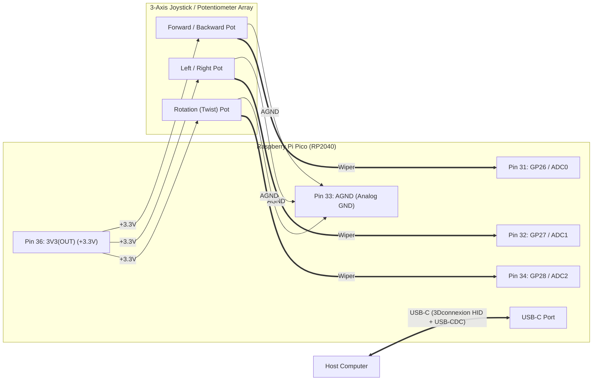

# pico-3d-mouse

Open-source **RP2040 3D CAD Mouse** featuring native **3Dconnexion SpaceMouse (`0x256F:0xC631`)** USB HID compatibility, a printable left-hand ergonomic two-piece enclosure, non-volatile QSPI Flash calibration, and a cross-platform **Qt6 MVC Manufacturing Tester, Calibration Wizard & Buttonless Firmware Updater**—built in **100% C++17** following **SOLID** principles and off-target **TDD** (GoogleTest + GMock).

---

## Table of Contents

1. [Overview & Key Features](#1-overview--key-features)
2. [3Dconnexion / CAD Compatibility & Axis Mapping](#2-3dconnexion--cad-compatibility--axis-mapping)
3. [Mechanical Enclosure & 3D Printing](#3-mechanical-enclosure--3d-printing)
4. [Hardware & Electrical Wiring](#4-hardware--electrical-wiring)
5. [Quick Start (Build, Test, Flash & Calibrate)](#5-quick-start-build-test-flash--calibrate)
6. [Manufacturing Tester & Calibration Wizard UI](#6-manufacturing-tester--calibration-wizard-ui)
7. [USB-CDC Serial Telemetry & Command Protocol](#7-usb-cdc-serial-telemetry--command-protocol)
8. [Software Architecture & Repository Layout](#8-software-architecture--repository-layout)

---

## 1. Overview & Key Features

- **Native 3Dconnexion SpaceMouse USB-C Composite Device (`VID = 0x256F`, `PID = 0xC631`)**:
  - **Interface 0 (`MI_00`, Endpoints `0x81` IN / `0x01` OUT)**: Emulates the **3Dconnexion SpaceMouse Pro Wireless (cabled)** 6-DOF Multi-Axis Controller HID descriptor (`Report ID 1` 12-byte 6-DOF translational + rotational vector in `[-350, +350]`, `Report ID 3` Buttons, and `Report ID 4` LED). Works out-of-the-box with **3DxWare 10** on Windows & macOS, **3DxWare Linux (`3dxsrv`)**, **Autodesk Fusion 360**, **SolidWorks**, **FreeCAD**, **Blender**, and `spacenavd`.
  - **Interfaces 1 & 2 (`MI_01`, Endpoints `0x82`, `0x03`, `0x83`)**: Standard USB-CDC ACM virtual serial port (`/dev/ttyACM*` on Linux, `COMx` via inbox `usbser.sys` on Windows) for live 12-bit ADC telemetry, interactive calibration, and buttonless firmware updates—with zero unknown vendor interfaces in Windows Device Manager.
- **100% Buttonless Firmware Updates**:
  - Enters RP2040 ROM `BOOTSEL` mode via the `BOOTSEL` serial command or a 1200-baud USB-CDC DTR touch—allowing firmware updates over the single USB-C cable when the Pico is sealed inside the 3D-printed enclosure.
- **Non-Volatile QSPI Flash Calibration Store**:
  - Persists per-axis resting center bias, mechanical min/max travel limits, deadzone thresholds, and polarity inversion flags in the final 4 KB sector of the RP2040 internal QSPI Flash, protected by a magic header, schema version, and **IEEE 802.3 CRC-32** checksum.
- **Cross-Platform Qt6 MVC Manufacturing Tester & Calibration UI (`./scripts/ui`)**:
  - 100% event-driven desktop application (zero polling timers) providing a guided 6-step operator calibration wizard, live 2D deflection + twist radar, per-axis 12-bit ADC gauges, QSPI Flash verification, and one-click buttonless UF2 flashing.
- **Printable Two-Piece Left-Hand Ergonomic Enclosure**:
  - Complete native Autodesk Fusion archive (`.f3d`), ready-to-print Bambu Studio `.3mf` plates, individual `.stl` meshes, TPU grip strips, and assembly documentation under [`mechanical/`](mechanical/README.md).

---

## 2. 3Dconnexion / CAD Compatibility & Axis Mapping

Because the hardware uses a 3-axis joystick/potentiometer assembly (2-axis gimbal deflection + Twist knob), the firmware maps the three conditioned analog channels onto the 6-DOF 3Dconnexion HID report (`tx, ty, tz, rx, ry, rz`) using the **Pan/Zoom + Twist (`tx, ty, rz`)** profile:

| Physical Input | RP2040 Pin / ADC | 6-DOF HID Axis | CAD Viewport Action | Output Range |
| :--- | :---: | :---: | :--- | :---: |
| **Joystick Forward / Backward** | `GP26` / `ADC0` | **`ty`** | Zoom In / Out (Forward / Backward) | `-350 .. +350` |
| **Joystick Left / Right** | `GP27` / `ADC1` | **`tx`** | Pan Left / Right | `-350 .. +350` |
| **Joystick Twist (CW / CCW)** | `GP28` / `ADC2` | **`rz`** | Rotate / Spin (Yaw Twist) | `-350 .. +350` |
| *Unused axes* | — | `tz`, `rx`, `ry` | Held at `0` | `0` |

> **Note**: Each active axis includes an automatic `±1` LSB keep-alive jiggle on consecutive identical non-zero reports so CAD drivers never mistake a held deflection for a stuck sensor, and sends an explicit all-zero report upon returning to the center deadzone.

---

## 3. Mechanical Enclosure & 3D Printing

The repository includes a left-hand ergonomic two-piece enclosure designed around the 3-axis joystick and USB-C RP2040 Pico board in [`mechanical/`](mechanical/README.md). It consists of an integrated base tray (`Base_Tray_print.stl`), a curved palm cap (`Palm_Cap_print.stl`) registered on four locating collars with heat-set M3 brass inserts, an internal PCB retainer (`PCB_Retainer_print.stl`), and four perimeter TPU grip strips—requiring zero glue.


<details>
<summary><strong>View Exploded Mechanical Assembly & Interior CAD Renders</strong></summary>


| Base Tray Interior | Palm Cap Underside |
| :---: | :---: |
|  |  |

</details>

### Key Mechanical Files & Guides

| Resource | Path |
| :--- | :--- |
| **Mechanical Overview & Orthographic Gallery** | [`mechanical/README.md`](mechanical/README.md) |
| **Detailed Assembly, Fastener BOM & Print Guide** | [`mechanical/output/two-piece/README.md`](mechanical/output/two-piece/README.md) |
| **Editable Native Fusion 360 Archive** | [`mechanical/output/two-piece/SpaceMouse_TwoPiece.f3d`](mechanical/output/two-piece/SpaceMouse_TwoPiece.f3d) |
| **Bambu Studio A1 Mini Plate — Base Tray** | [`mechanical/output/two-piece/PRINT_Base_Tray_A1mini.3mf`](mechanical/output/two-piece/PRINT_Base_Tray_A1mini.3mf) |
| **Bambu Studio A1 Mini Plate — Palm Cap + PCB Retainer** | [`mechanical/output/two-piece/PRINT_Top_and_PCB_Retainer_A1mini.3mf`](mechanical/output/two-piece/PRINT_Top_and_PCB_Retainer_A1mini.3mf) |
| **Joystick Manufacturer Datasheet** | [`mechanical/om300b.pdf`](mechanical/om300b.pdf) |

---

## 4. Hardware & Electrical Wiring

The Raspberry Pi Pico (RP2040) connects to the host computer over **USB-C**. The outer terminals of all three potentiometers are wired in parallel across `3V3(OUT)` (Pin 36) and `AGND` (Pin 33), with their center wipers routed to `ADC0`, `ADC1`, and `ADC2`:

| Axis / Signal | Potentiometer Terminal | RP2040 GPIO | ADC Channel | Physical Pin |
| :--- | :--- | :---: | :---: | :---: |
| **Forward / Backward (`ty`)** | Wiper | `GP26` | `ADC0` | **Pin 31** |
| **Left / Right (`tx`)** | Wiper | `GP27` | `ADC1` | **Pin 32** |
| **Rotation / Twist (`rz`)** | Wiper | `GP28` | `ADC2` | **Pin 34** |
| **Potentiometer +V** | High side (all 3 pots) | `3V3(OUT)` | — | **Pin 36** |
| **Potentiometer GND** | Low side (all 3 pots) | `AGND` | — | **Pin 33** |
| **Status LED** | Onboard LED | `GP25` | — | Onboard |



See [`docs/WIRING.md`](docs/WIRING.md) and [`docs/pinout.png`](docs/pinout.png) for the full schematic, solder checklist, and board pinout diagram.

---

## 5. Quick Start (Build, Test, Flash & Calibrate)

### Step 1: Clone the Repository

```bash
git clone https://github.com/Mrunmoy/pico-3d-mouse.git
cd pico-3d-mouse
```

### Step 2: Set Up the Hermetic Nix Environment

All toolchains and dependencies—`g++`, `arm-none-eabi-gcc`, `pico-sdk 2.2.0` (with TinyUSB submodules), `qt6` (`qtbase`, `qtserialport`), `gtest`/`gmock`, `cmake`, `ninja`, and `picotool`—are pinned inside `flake.lock`.

If you don't have Nix installed yet, install it with Flakes enabled via the [Determinate Nix Installer](https://github.com/DeterminateSystems/nix-installer):

```bash
curl --proto '=https' --tlsv1.2 -sSf -L https://install.determinate.systems/nix | sh -s -- install
```

Every helper script in `./scripts/` automatically enters `nix develop` if needed, or you can enter the interactive shell once:

```bash
nix develop
```

### Step 3: Build Firmware, Host Unit Tests & Qt6 Desktop UI

Builds all host unit tests (`build/`), the Qt6 MVC Manufacturing Tester & Firmware Updater desktop app (`build/src/ui/app/pico_3d_mouse_ui`), and the RP2040 UF2 firmware image (`firmware/build/apps/pico_3d_mouse/pico_3d_mouse.uf2`):

```bash
./scripts/build
```

### Step 4: Run All Colocated Unit Tests (ASan + UBSan)

Runs all **59 colocated GoogleTest / GMock unit tests** across 16 test suites with AddressSanitizer and UndefinedBehaviorSanitizer enabled:

```bash
./scripts/test
```

### Step 5: Flash Firmware to the Raspberry Pi Pico (100% Buttonless)

Connect the Raspberry Pi Pico over USB-C and run `./scripts/flash`. It builds the latest UF2, triggers a buttonless reboot into `BOOTSEL` mode over USB-CDC, flashes `pico_3d_mouse.uf2`, reboots into the application, and streams 5 seconds of live USB-CDC verification logs:

```bash
./scripts/flash pico_3d_mouse 5
```

### Step 6: Launch the Qt6 Manufacturing Tester & Calibration Wizard

Launch the desktop application (auto-detects the Pico's `/dev/ttyACM*` port, or accepts an explicit port argument):

```bash
./scripts/ui
# Or specify a serial port explicitly:
./scripts/ui /dev/ttyACM0
```

---

## 6. Manufacturing Tester & Calibration Wizard UI

The cross-platform Qt6 desktop application (`./scripts/ui`) guides operators through end-of-line hardware bring-up, axis calibration, and QSPI Flash verification:

[](docs/media/manufacturing_demo.mp4)

> **Full Video**: [Watch / Download MP4 (`docs/media/manufacturing_demo.mp4`)](docs/media/manufacturing_demo.mp4)

| Live 3-DOF Telemetry & Direction/Deadzone Tuning | Final Manufacturing Pass & QSPI Flash Sign-Off |
| :---: | :---: |
|  |  |

### Guided 6-Step Calibration Workflow

1. **Connect Device**: Select the Pico's USB-CDC port (`/dev/ttyACM*` or `COMx`) and verify live 20 Hz `@RAW` telemetry.
2. **Capture Resting Center (`ZERO`)**: Release the joystick so it rests neutrally and capture the per-axis ADC center bias.
3. **Full-Range Axis Sweep (`CAL_MINMAX_START` / `CAL_MINMAX_END`)**: Deflect the joystick fully forward, backward, left, and right, and twist fully CW and CCW to record the mechanical travel limits (`min`/`max`).
4. **Direction & Deadzone Tuning (`SET_DZ` / `SET_INV`)**: Verify deflection polarity on the 2D radar and adjust per-axis deadzone counts to eliminate resting jitter.
5. **Save to QSPI Flash (`SAVE_CAL`)**: Commit the calibration profile with an IEEE 802.3 CRC-32 checksum to RP2040 non-volatile QSPI Flash.
6. **Final Sign-Off**: Confirm all three axes show green `PASS` badges and QSPI Flash persistence is verified.

---

## 7. USB-CDC Serial Telemetry & Command Protocol

The USB-CDC interface (`115200 8N1`) streams live telemetry at 20 Hz and accepts newline-terminated ASCII commands (`\n` or `\r\n`):

### Telemetry Stream (`@RAW`)

```text
@RAW t_ms=12500 ch0_raw=2117 ch0_mv=1705 ch0_d=0 ch0_s=0 ch1_raw=2117 ch1_mv=1705 ch1_d=0 ch1_s=0 ch2_raw=2113 ch2_mv=1702 ch2_d=0 ch2_s=0
```

### Calibration & Control Commands

| Command | Description | Response |
| :--- | :--- | :--- |
| `ZERO` | Capture current ADC readings as resting center (`c`) for all 3 channels | `@CAL ZERO_OK CH0[...] CH1[...] CH2[...]` |
| `CAL_MINMAX_START` | Begin live min/max mechanical travel tracking across all 3 channels | `@CAL MINMAX_START CH0[...] ...` |
| `CAL_MINMAX_END` | Stop live min/max tracking and lock captured endpoints | `@CAL MINMAX_END CH0[...] ...` |
| `SET_DZ <ch> <val>` | Set deadzone threshold (`0..2000` ADC counts) for channel `0..2` | `@CAL SET_DZ_OK ...` |
| `SET_INV <ch> <0\|1>` | Set polarity inversion (`0` = normal, `1` = inverted) for channel `0..2` | `@CAL SET_INV_OK ...` |
| `SAVE_CAL` | Write active calibration with CRC-32 to RP2040 QSPI Flash | `@CAL SAVED_OK ...` |
| `LOAD_CAL` | Reload saved calibration from RP2040 QSPI Flash | `@CAL LOADED_OK ...` / `LOAD_DEFAULTS` |
| `RESET_CAL` | Reset all channels to factory default calibration (`c=2048, min=0, max=4095, dz=32, inv=0`) | `@CAL RESET_OK ...` |
| `GET_CAL` | Query active calibration parameters for all 3 channels | `@CAL STATUS ...` |
| `BOOTSEL` | Reboot RP2040 immediately into ROM USB `BOOTSEL` mass-storage / `picotool` mode | `@BOOTSEL ENTERING` |

---

## 8. Software Architecture & Repository Layout

Every firmware and desktop UI module under `src/` is structured around pure abstract interfaces (SOLID Dependency Inversion) and owns its own `CMakeLists.txt`, public `include/`, implementation, and colocated `test/CMakeLists.txt` unit test suite:

```text
.
├── CMakeLists.txt                                  # Root host build & CTest entry point
├── flake.nix / flake.lock                          # Hermetic Nix environment (toolchains, Pico SDK, Qt6, GTest)
├── mechanical/                                     # Ergonomic 2-piece enclosure CAD, 3MF/STL print files & assembly docs
│   ├── README.md                                   # Mechanical design overview & orthographic CAD gallery
│   ├── docs/images/                                # Shaded CAD renders (assembled, exploded, orthographic views)
│   └── output/two-piece/                           # Master Fusion .f3d, Bambu A1 mini .3mf plates, STLs & BOM guide
├── docs/
│   ├── WIRING.md                                   # Detailed electrical schematic & solder checklist
│   ├── pinout.png                                  # RP2040 board pinout reference
│   └── media/                                      # Manufacturing Tester UI screencast & screenshots
├── scripts/
│   ├── build                                       # Build host tests, Qt6 UI, and RP2040 UF2 firmware
│   ├── test                                        # Run all 59 colocated unit tests with ASan + UBSan
│   ├── flash                                       # Buttonless auto-build, flash UF2, and capture serial logs
│   ├── ui                                          # Launch Qt6 MVC Manufacturing Tester & Updater UI
│   └── console                                     # Open interactive picocom console on /dev/ttyACM*
├── src/
│   ├── cmake/p3d.cmake                             # Module & colocated test registration helpers
│   ├── hal/                                        # Pure abstract HAL interfaces + GMock test_support + test/
│   ├── platform/rp2040/                            # Concrete RP2040 Pico SDK & TinyUSB adapters + test/
│   ├── drivers/
│   │   ├── adc_channel/                            # OversampledAdcChannel + test/
│   │   └── pot_array/                              # PotentiometerArray + test/
│   ├── domain/
│   │   ├── axis_processor/                         # Deadzone, range scaling, inversion, clamping, EMA + test/
│   │   ├── calibration_store/                      # IEEE 802.3 CRC-32 QSPI Flash calibration store + test/
│   │   ├── command_parser/                         # Zero-allocation serial command parser + test/
│   │   └── app_controller/                         # Control loop, 6-DOF HID mapping, calibration, BOOTSEL + test/
│   └── ui/                                         # Cross-platform Qt6 MVC Desktop Application
│       ├── interfaces/                             # ISerialTransport, IFirmwareUpdater, IProcessRunner + test/
│       ├── services/                               # QtSerialTransport, PicotoolFirmwareUpdater + test/
│       ├── models/                                 # DeviceTelemetryModel (telemetry, cal, mfg checks) + test/
│       ├── widgets/                                # Decoupled SOLID Custom Widgets (each with test/)
│       │   ├── manufacturing_wizard/               # Guided 6-step operator calibration wizard + test/
│       │   ├── gimbal_radar/                       # 2D X/Y deflection radar + twist arc + test/
│       │   ├── axis_gauge/                         # 12-bit ADC bar, mV, deadzone, watermarks & pass badge + test/
│       │   ├── calibration_panel/                  # Interactive calibration & QSPI Flash controls + test/
│       │   └── firmware_updater/                   # Buttonless USB-C UF2 firmware updater + test/
│       ├── controllers/                            # ManufacturingController + test/
│       └── app/                                    # MainWindow + pico_3d_mouse_ui executable + test/
└── firmware/
    ├── CMakeLists.txt                              # RP2040 cross-compilation entry point
    └── apps/pico_3d_mouse/                         # RP2040 composition root -> pico_3d_mouse.uf2
```
