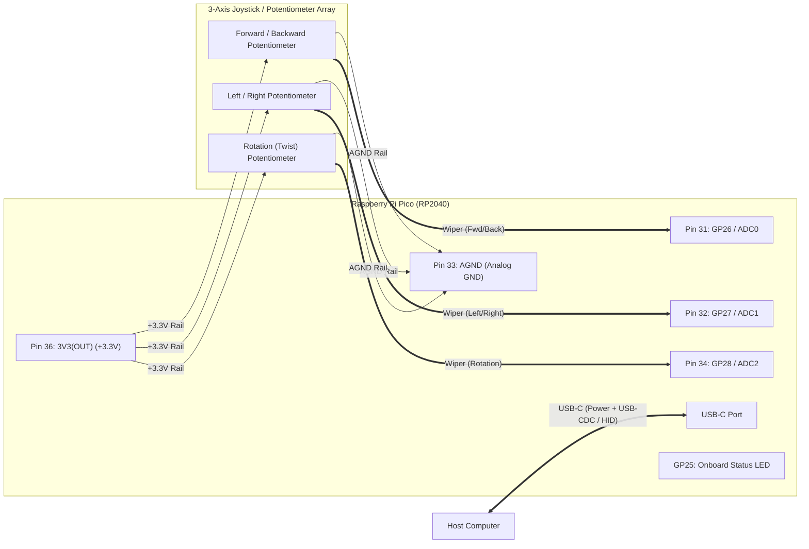
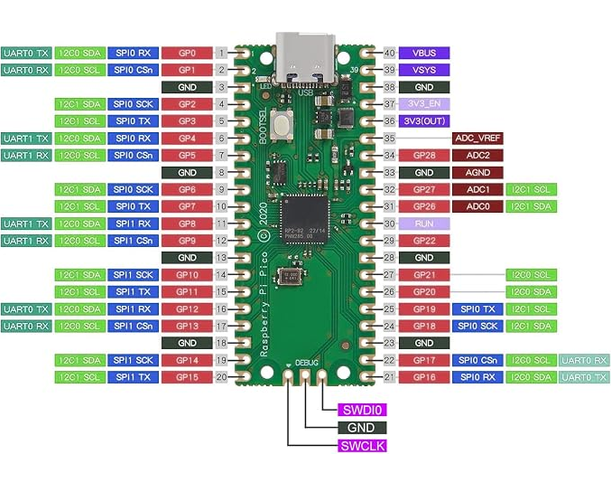

# Hardware Wiring Diagram (`pico-3d-mouse`)

## Overview

The Raspberry Pi Pico (RP2040, USB-C) connects to the host computer over USB-C and reads three potentiometer wipers tied across the Pico's analog supply (`3V3(OUT)`, Pin 36) and analog ground (`AGND`, Pin 33).



## Schematic & Pin Connections

```text
                      ┌─────────────────────────────────────┐
                      │         HOST COMPUTER (PC)          │
                      └──────────────────┬──────────────────┘
                                         │
                                    USB-C Cable
                                         │
                    ┌────────────────────┴────────────────────┐
                    │               [ USB-C ]                 │
                    │                                         │
                    │         Raspberry Pi Pico (RP2040)      │
                    │                                         │
                    │                           Pin 36        │
                    │                         3V3(OUT) ───────┼───────┬───────────────┬───────────────┐
                    │                                         │       │               │               │
                    │                           Pin 34        │      ┌┴┐             ┌┴┐             ┌┴┐
                    │                      GP28 / ADC2 <──────┼──────┤ │<─ Wiper     │ │             │ │
                    │                                         │      │ │  ROTATION   │ │  LEFT/RIGHT │ │  FWD/BACK
                    │                           Pin 33        │      └┬┘  (Twist)    └┬┘             └┬┘
                    │                             AGND ───────┼───┬───┴───────────────┴───────────────┘
                    │                                         │   │                   ▲               ▲
                    │                           Pin 32        │   │                   │ Wiper         │ Wiper
                    │                      GP27 / ADC1 <──────┼───┼───────────────────┘               │
                    │                                         │   │                                   │
                    │                           Pin 31        │   │                                   │
                    │                      GP26 / ADC0 <──────┼───┼───────────────────────────────────┘
                    │                                         │   │
                    │  [GP25 Status LED]                      │  ─┴─ AGND
                    └─────────────────────────────────────────┘
```

## Pin Mapping Reference

| Axis / Signal | Potentiometer Terminal | RP2040 GPIO | ADC Channel | Physical Pin |
| :--- | :--- | :--- | :---: | :---: |
| **Forward / Backward** | Wiper | `GP26` | `ADC0` | **Pin 31** |
| **Left / Right** | Wiper | `GP27` | `ADC1` | **Pin 32** |
| **Rotation (Twist)** | Wiper | `GP28` | `ADC2` | **Pin 34** |
| **Analog +3.3 V Supply** | High end of all 3 pots | `3V3(OUT)` | — | **Pin 36** |
| **Analog Ground** | Low end of all 3 pots | `AGND` | — | **Pin 33** |
| **Status Heartbeat LED** | Onboard LED | `GP25` | — | Onboard |


