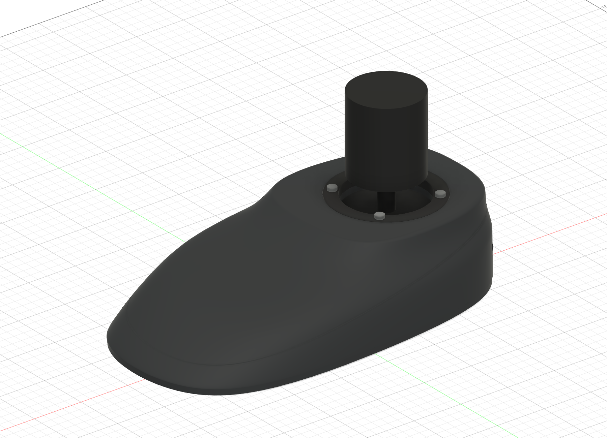
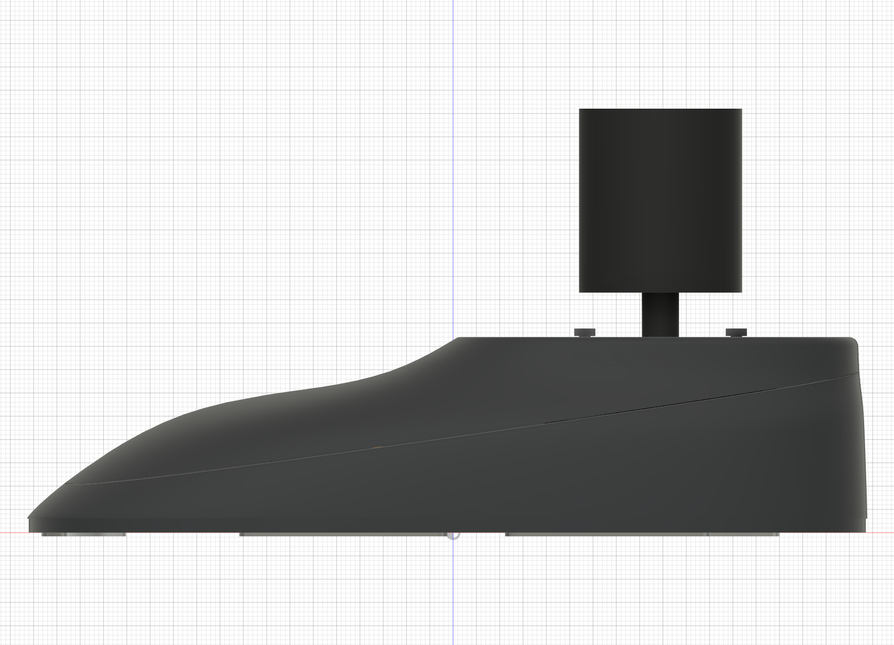
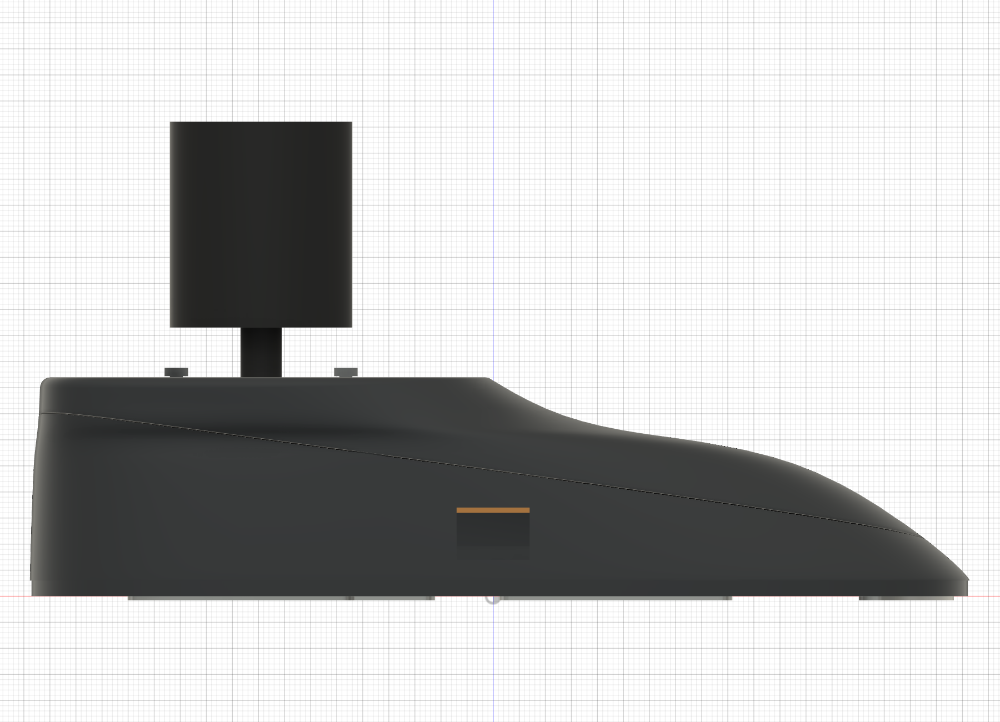
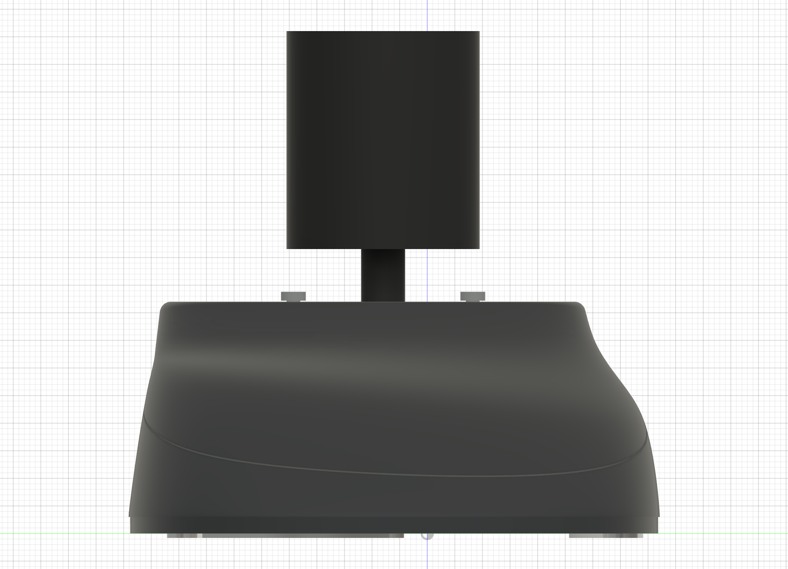
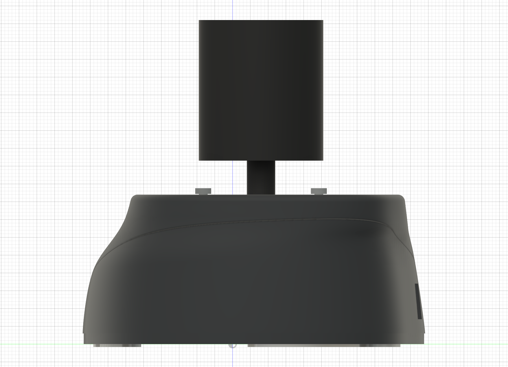
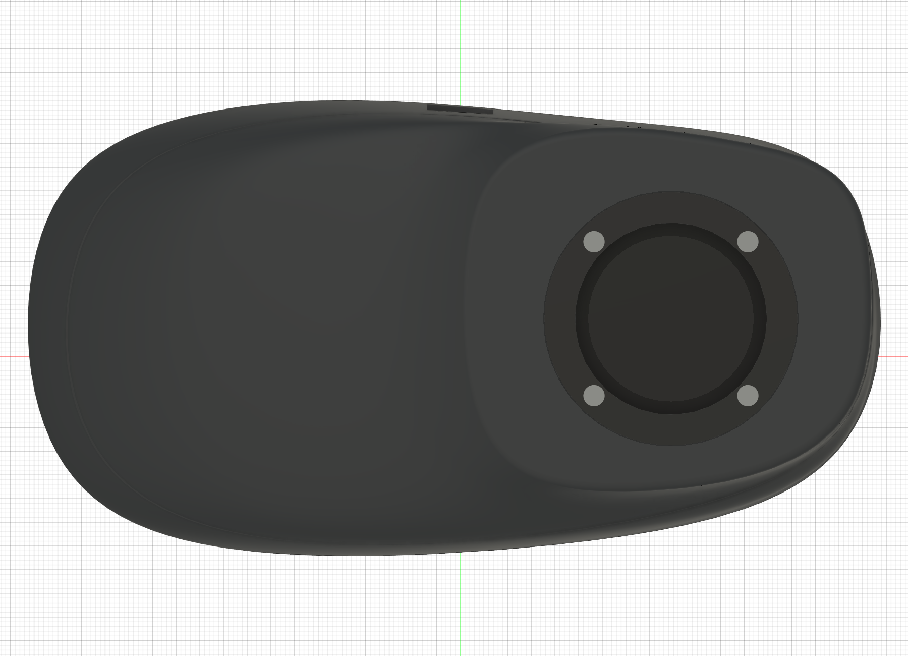
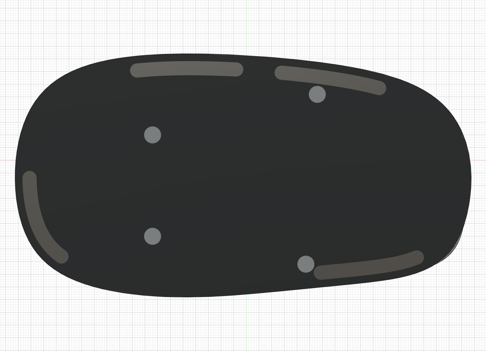
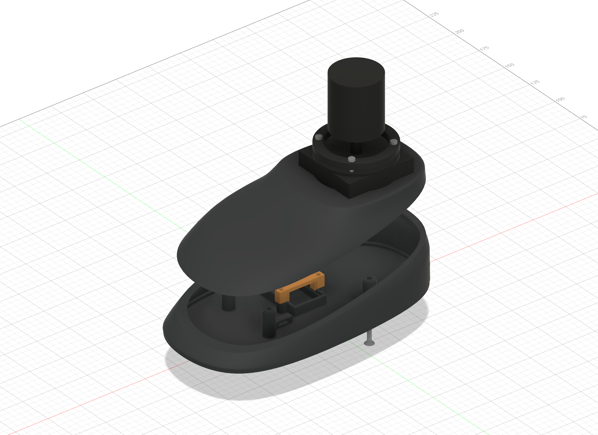
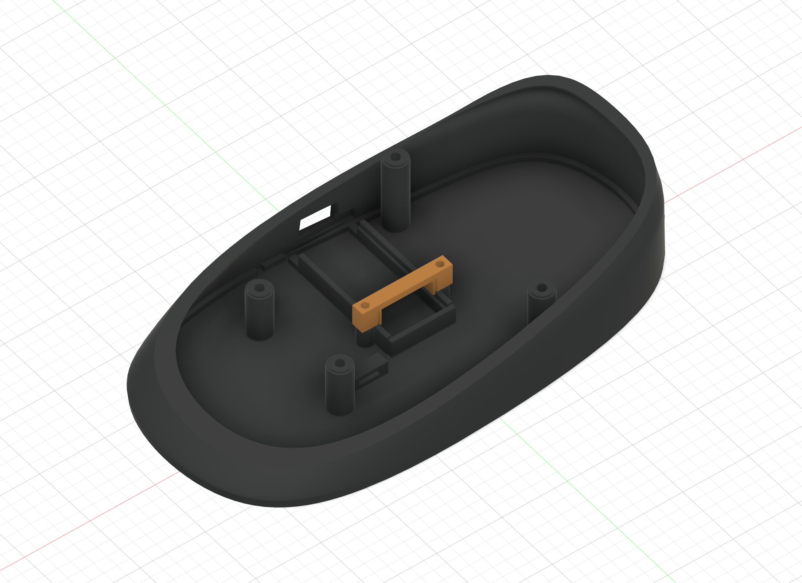
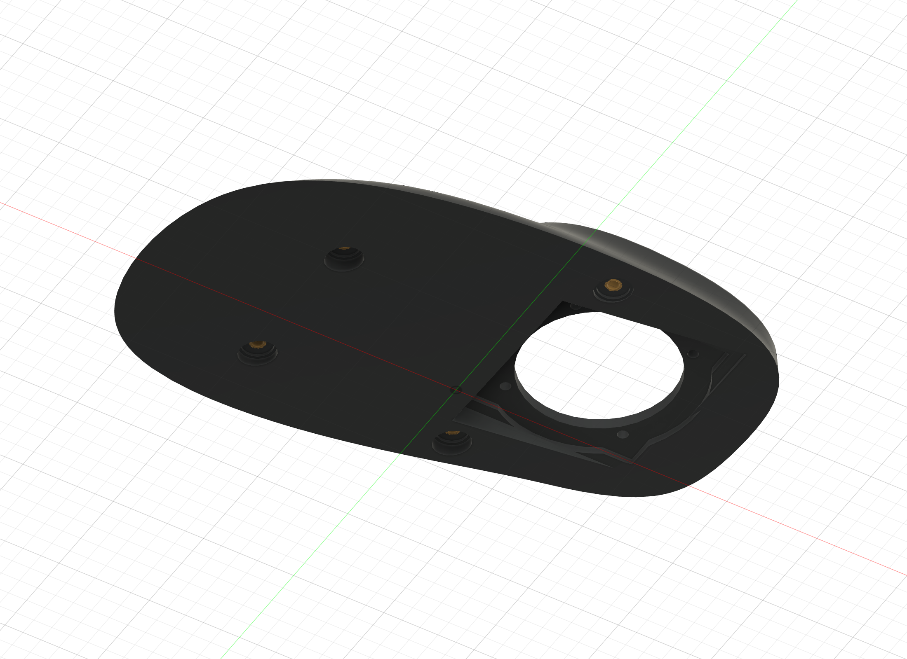

# SpaceMouse mechanical design

Left-hand ergonomic enclosure for the project's joystick and USB-C RP2040 Pico board. Two main enclosure parts: integrated base tray and registered curved palm cap, with a separate PCB retainer and TPU perimeter strips. No enclosure glue is needed.

## Current files

| Purpose | File |
|---|---|
| Editable native Fusion master, saved cloud version 7 | [SpaceMouse_TwoPiece.f3d](output/two-piece/SpaceMouse_TwoPiece.f3d) |
| Top cover and PCB clamp on one prepared A1 mini plate | [PRINT_Top_and_PCB_Retainer_A1mini.3mf](output/two-piece/PRINT_Top_and_PCB_Retainer_A1mini.3mf) |
| Base tray print project | [PRINT_Base_Tray_A1mini.3mf](output/two-piece/PRINT_Base_Tray_A1mini.3mf) |
| Individual high-resolution meshes | [Cap](output/two-piece/Palm_Cap_print.stl), [tray](output/two-piece/Base_Tray_print.stl), [PCB clamp](output/two-piece/PCB_Retainer_print.stl) |
| Assembly, hardware, print settings and validation | [Assembly guide](output/two-piece/README.md) |
| Original design brief | [Engineering specification](SpaceMouse_Concept_C_Engineering_Spec.md) |
| Joystick manufacturer drawing | [PDF](om300b.pdf) |

Only `output/two-piece/` is the current enclosure release. Obsolete variation folders and rebuild scripts have been removed; recover them from Git history when needed. The native model retains earlier source components, which are hidden and not printable accessories.

## CAD gallery

These are shaded views exported from the actual saved CAD, not photographs or AI concepts. Joystick, electronics and hardware are simplified engineering references. Left/right refer to the enclosure viewed from the wrist edge: wrist is -Y, USB is +Y, joystick is +X (right), palm support extends left.

| Front / wrist edge | Rear / USB edge |
|---|---|
|  |  |

| Left / palm end | Right / joystick end |
|---|---|
|  |  |

| Top | Bottom |
|---|---|
|  |  |

### Exploded assembly

| Tray interior | Cap underside |
|---|---|
|  |  |

## Fasteners and assembly

- Case: 2 x M3x25, 1 x M3x30, 1 x M3x35 ISO 10642 90-degree countersunk machine screws.
- Case inserts: 4 x M3, length 4 mm, outside diameter 4.2 mm (3DZWMAN Amazon ASIN B0BBSLL6G7). Cap pilots are editable: diameter 3.8 mm, depth 4.8 mm. This is an engineering starting fit; physical retention has not yet been tested. The user's 5.7 mm-long inserts are not compatible with this low cap.
- Joystick: 4 x M2.5x12 pan-head machine screws. M2.5 thread is from the manufacturer drawing; 12 mm is the modeled length, subject to checking the actual flange thread depth before tightening.
- PCB retainer: 2 x M2.5x12 pan-head machine screws into printed pilots, gently tightened without inserts.

Follow the detailed assembly guide linked above. Physical fit/strength and final print quality remain hardware validation tasks. Wiring and firmware are documented in [the main project](../README.md) and [WIRING.md](../docs/WIRING.md). The actual hardware has three potentiometers (including twist); this supersedes the original brief's two-axis assumption.

## Printing

The current combined cap/clamp plate was sliced for A1 mini, 0.4 mm nozzle, eSun PLA+, textured PEI, 0.12 mm layers, 3 walls, 15% gyroid and 5 mm brim with local tree supports. Estimate: 4 h 11 min / 54.32 g. Cap curved palm surface faces up. Keep its broad joint face down: tilting lifts almost all direct bed contact and requires substantial support. No automatic print command is part of this workflow.

## Editing and regeneration

All future mechanical changes belong in this repository under `mechanical/`. Preserve the existing single cloud document in the SpaceMouse project; do not create multiple master designs. Cloud identity: `urn:adsk.wipprod:dm.lineage:Oa1GpTwQR8iVvi6D4SRQIg`.

1. Open the current F3D locally if Fusion cloud access is unavailable. Editing a local import does not automatically update the original cloud document: reconcile it deliberately once online.
2. Register `mechanical/scripts/ConceptC_FitTest` in Fusion's Scripts and Add-Ins panel. The dispatcher reads a deliberately queued JSON request from `mechanical/scripts/ConceptC_Complete/queued.json`; review the requested action before running it. Only `project_gallery` and `amazon_inserts` are supported; obsolete rebuild and cloud-cleanup actions have been removed.
3. Scripts now resolve paths relative to `mechanical/`, independent of checkout location. The scripts use Fusion's `adsk` Python API and must run inside Fusion; mesh/slicer packaging scripts run externally with NumPy and local Bambu Studio.
4. After modifying CAD, save/update the master archive, regenerate the corresponding meshes and slicer projects, validate geometry and print orientation, refresh this gallery, and commit the affected files together.
5. To refresh all orthographic views, queue `{"action":"project_gallery"}` and run the dispatcher. This imports the saved local master and exports to `docs/images/` without saving cloud geometry. Exploded/internal views are currently maintained with `two_piece.finish`; refresh them when geometry changes.

The exterior includes preserved BRep geometry derived from prior parametric lofts; not every exterior shape is driven by a single live parameter. Current fasteners, insert pockets and registration features remain editable. Earlier builders and baselines are recoverable from Git history, rather than kept in working folders.

## Migration

On 29 October 2026 the original mechanical repository through commit `147712c` was imported as a Git subtree, preserving its history. This `pico-3d-mouse` repository is now the authoritative location for mechanical, electronics and firmware work. Personal source photographs and untracked scratch exports were not imported.

## Retired variations

On 29 October 2026 obsolete ergonomic trials, split concepts, fit-test builders and pre-release exports were removed from the working tree. Recover them from commit `876aab3` or earlier; all history remains in this repository. Current source components inside the native CAD are preserved to avoid breaking its feature timeline. Four current-handed TPU strip STLs are supplied beside the rigid-part STLs; slice these separately using your TPU profile. Their native bodies also remain in the master.

TPU accessories: [strip 1](output/two-piece/TPU_Strip_1_print.stl), [strip 2](output/two-piece/TPU_Strip_2_print.stl), [strip 3](output/two-piece/TPU_Strip_3_print.stl), [strip 4](output/two-piece/TPU_Strip_4_print.stl).
